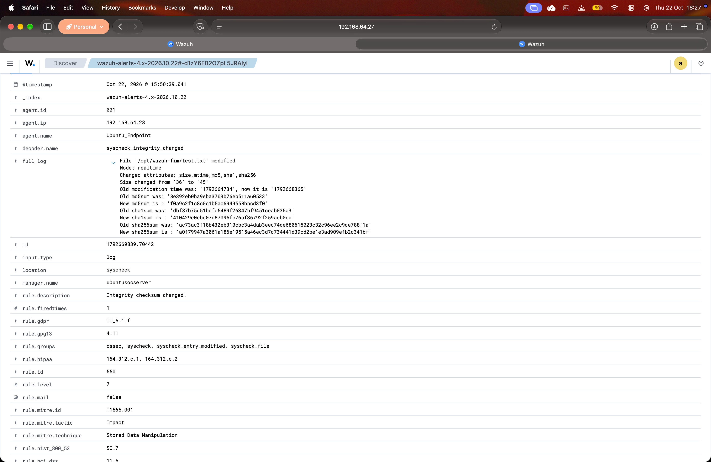
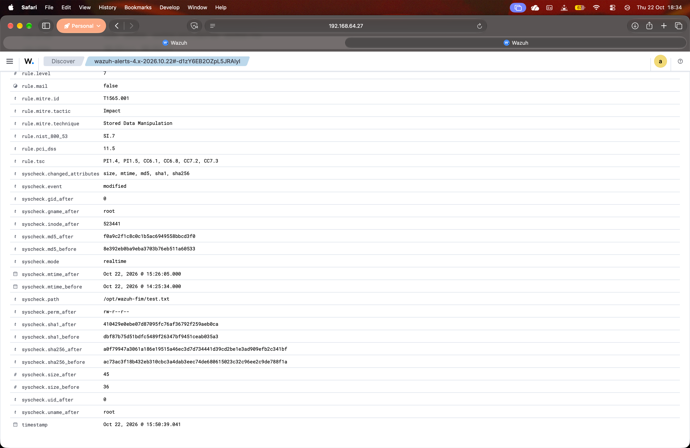
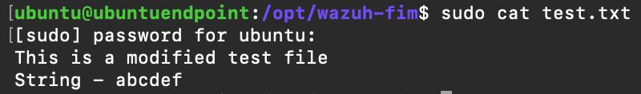
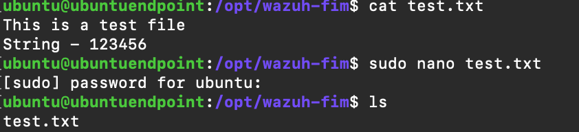

# IR-2026-001 | FIM File Addition

**Date/Time of Alert:** Oct 22, 2026 @ 15:50 GMT+4
**Analyst:** Pavan Pavithran
**Severity:** Low  
**Status:** Closed
**Final Disposition:** Benign - Authorized User Activity

---
## Summary

On October 22, 2026 at 15:50 GMT+4, the Wazuh File Integrity Monitoring (FIM) detected and generated an alert for stored data manipulation involving /opt/wazuh-fim/test.txt on the endpoint Ubuntu_Endpoint involving the user root. Investigation revealed that the alert was triggered by a legitimate user modifying the file for testing purposes, resulting in no security impact or compromise.

---
## Investigation

### File Integrity Alert

**Evidence reviewed:** Wazuh alert JSON

**Results:** 
- Alert rule ID: 550  
- Alert description: `Integrity checksum changed.`
- Affected endpoint: `Ubuntu_Endpoint`
- Agent ID: `001`
- File path: `/opt/wazuh-fim/test.txt`
- Event type: `File modified`
- Rule level: `7` 

### File Metadata and Integrity Information

**Evidence reviewed:** The `syscheck` fields in the Wazuh alert JSON.

The alert provided metadata and hashes that can be used to document the file observed during the investigation. These values do not, by themselves, establish whether the file is malicious.

### Activity Verification

**Investigation actions:**

1. Confirmed that the file creation was intentional. 
2. Inspected the file contents. 
   
   
3. Reviewed corroborating evidence associated with the planned test activity.
   

The file operation was confirmed to be intentional and associated with authorized lab activity.

No incident escalation or remediation was required for this controlled test event. FIM monitoring should remain enabled.

## Findings

1. **Detection validated:** Wazuh correctly generated an alert for a file modification in the monitored directory.
2. **Activity verified:** The file operation was confirmed to be intentional and performed as part of authorized lab testing.
3. **Benign disposition:** The evidence supports classifying the event as benign authorized activity.
4. **Detection quality:** This was a valid detection of file activity, not a failure of the FIM mechanism.

## Recommendations

- Keep FIM monitoring enabled for `/opt/wazuh-fim`.
- Record the timestamps and expected file operations associated with planned tests.
- Continue correlating alerts with endpoint evidence and authorized activity.

## Final Disposition

**Disposition:** Benign — Authorized User Activity

**Closure rationale:** Wazuh correctly detected the file addition. Investigation confirmed that the operation was intentional, the file contents were inspected, and corroborating evidence supported the planned test activity. No further response was required for this event.

![[IR-2026-001-alert-details.png]]

